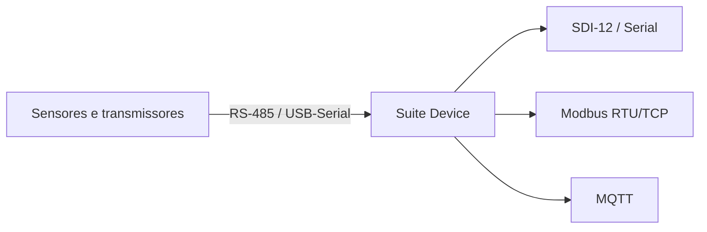
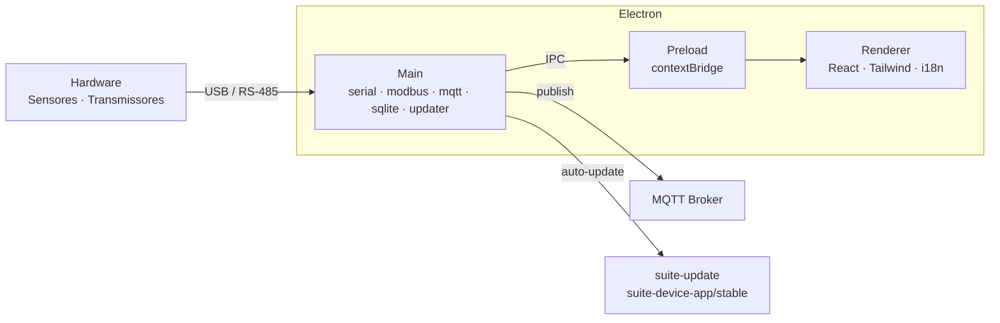

<div align="center">

# Suite Device

### Plataforma desktop para configuração e comunicação com dispositivos Dualbase

[](https://github.com/DhioneCastilhoBarbosa/suite-device-app/releases)
[](https://www.electronjs.org/)
[](https://react.dev/)
[](https://www.typescriptlang.org/)
[](#)

**Configure sensores · Comunique-se com transmissores · Publique dados via MQTT**

[Início rápido](#início-rápido) · [Dispositivos](#dispositivos-suportados) · [Protocolos](#protocolos) · [Arquitetura](#arquitetura) · [Build](#build--distribuição) · [Updates](#auto-update--telemetria)

</div>

---

## Visão geral

O **Suite Device** é uma aplicação desktop instalável que conecta o computador a sensores ambientais, dataloggers e transmissores de campo. Desenvolvido pela **Dualbase**, funciona como bridge entre o sistema operacional e o hardware — com interface gráfica, persistência local e integração IoT.

| Capacidade | Descrição |
|:---|:---|
| **Configuração** | Ajuste parâmetros, endereços e unidades via UI dedicada por produto |
| **Comunicação** | SDI-12, Modbus RTU/TCP, Serial e MQTT |
| **Firmware** | Atualização de dispositivos (ex.: PluviDB-IoT via mcumgr) |
| **Dados** | Armazenamento local (SQLite) e exportação de leituras/logs |
| **Idiomas** | Português, Inglês e Espanhol |

---

## Dispositivos suportados

Interfaces modulares para a linha Dualbase:

| Dispositivo | Função |
|:---|:---|
| **Terminal-SDI12** | Terminal transparente e atalhos para sensores SDI-12 |
| **LimniDB-Borbulha** | Sensor de nível por borbulhamento |
| **LimniDB-CAP** | Sensor de nível capacitivo |
| **Teclado-SDI12** | Configuração de variáveis e comandos SDI-12 |
| **TSatDB** | Transmissor satelital (GPS, RF, apontamento de antena) |
| **PluviDB-IoT** | Pluviômetro IoT (local e remoto, firmware, MQTT) |
| **Modbus** | Configuração e atualização de firmware Modbus |

---

## Protocolos



| Protocolo | Uso |
|:---|:---|
| **SDI-12** | Sensores digitais ambientais (`I!`, `M!`, `D0!`, …) — half-duplex, 1200 baud |
| **Modbus** | RTU (serial) e TCP (rede) — holding/input registers, coils |
| **Serial** | RS-232 / USB genérico; payloads CBOR (mcumgr) |
| **MQTT** | Publicação para brokers e plataformas IoT (QoS 0/1/2) |

---

## Stack

| Camada | Tecnologia |
|:---|:---|
| Desktop | Electron 25 · electron-vite · **electron-builder** |
| UI | React 18 · TypeScript · Tailwind CSS · Radix UI · Phosphor Icons |
| Hardware | `serialport` · `modbus-serial` · `mqtt` · `cbor-x` |
| Dados | SQLite · electron-store · Zod · file-saver |
| i18n | i18next · react-i18next (PT · EN · ES) |
| Updates | electron-updater 6.3.0-alpha.4 · feed generic (suite-update) |

> Electron Forge foi removido. Use apenas electron-builder.

---

## Início rápido

### Requisitos

- **Node.js** 18+ (LTS recomendado)
- **npm** 9+
- **Windows:** Visual Studio Build Tools (módulos nativos: `serialport`, `sqlite3`)
- **Git**

### Instalação

```bash
git clone https://github.com/DhioneCastilhoBarbosa/suite-device-app.git
cd suite-device-app
npm install
```

> O `postinstall` aplica patches via `patch-package`. Se módulos nativos falharem após troca de Node/Electron:

```bash
npm run rebuild
```

### Desenvolvimento

```bash
npm run dev          # hot reload (main + preload + renderer)
npm run typecheck    # TypeScript
npm run lint         # ESLint
npm run format       # Prettier
```

Copie `.env.example` → `.env` se for testar telemetria/build com overrides.

---

## Scripts

| Comando | O que faz |
|:---|:---|
| `npm run dev` | App em modo desenvolvimento |
| `npm run build` | Typecheck + electron-vite + cópia de `resources/` |
| `npm run build:win` | Ícone + build + pacote Windows (NSIS) |
| `npm run build:mac` | Build + pacote macOS (zip + DMG) |
| `npm run build:linux` | Build + pacote Linux (AppImage) |
| `npm run publish` | **Transição:** build Win + upload GitHub Releases (requer `GH_TOKEN` + `gh`) |
| `npm run icons:generate` | Gera `.ico` para Windows |
| `npm run rebuild` | Recompila addons nativos |

---

## Arquitetura



| Processo | Responsabilidade |
|:---|:---|
| **Main** | Serial, Modbus, SDI-12, MQTT, SQLite, preferências, auto-update + telemetria |
| **Preload** | Expõe APIs seguras via `contextBridge` (sem Node no renderer) |
| **Renderer** | Interface React, validação Zod, toasts, i18n |

---

## Estrutura do projeto

```text
suite-device-app/
├── src/
│   ├── main/                 # Processo principal Electron
│   │   └── updater/          # Telemetria + pending-install
│   ├── preload/
│   ├── renderer/src/
│   ├── locales/
│   └── db/                   # SQLite (suite-device.db em userData)
├── config/                   # default-feed.json · default-telemetry.json
├── resources/                # Ícones, app-update.yml, binários auxiliares
├── scripts/                  # build-*, publish-win, publish-remote
├── .github/workflows/        # publish-windows / mac / linux
├── electron-builder.yml
└── electron.vite.config.ts
```

---

## Build & distribuição

Só **electron-builder**. Artefatos saem em `release/` (código compilado continua em `dist/`).

| Plataforma | Formato | Comando |
|:---|:---|:---|
| Windows | NSIS `.exe` + `.blockmap` + `latest.yml` | `npm run build:win` |
| macOS | `.zip` (+ blockmap) + `latest-mac.yml` (+ DMG manual) | `npm run build:mac` |
| Linux | AppImage + `latest-linux.yml` | `npm run build:linux` |

O feed embutido (`app-update.yml`) é **generic**:

`https://app-suite-update.dualbase.com.br/suite-device-app/stable`

Override na build: `UPDATE_SERVER_URL` (ver `.env.example`).

### Identidade (NÃO alterar)

Preservar para não perder dados dos clientes (`userData`):

| Campo | Valor |
|:---|:---|
| `appId` | `com.electron.app` |
| `productName` | `suite-device-app` |
| `executableName` | `suite-device-app` |
| Atalho NSIS | `Suite Device` |
| SQLite | `app.getPath('userData')` + `suite-device.db` |

---

## Auto-update & telemetria

### Transição de provider

1. **Clientes 2.4.x** ainda usam provider **GitHub** → descobrem a versão de transição no GitHub Releases.
2. O instalador da versão de transição (> 2.4.5) embute `app-update.yml` com provider **generic** (servidor próprio).
3. **Versões seguintes** publicam só no servidor (`destination=server`).

### Telemetria

Fire-and-forget para a API suite-update (`POST /v1/telemetry/events`, header `X-Telemetry-Token`):

| Tipo | Quando |
|:---|:---|
| `update_check` | Verificação de update |
| `download` | `outcome: requested` / `completed` (+ `range` no pedido) |
| `installation` | Confirmada após restart (`pending-install.json` em userData) |
| `failure` | `stage: check` \| `download` \| `install` |

`application`: `suite-device-app`. Canal derivado do feed (`stable` / `beta`).

Config: `config/default-telemetry.json` (URL da API) + env de build `TELEMETRY_*` gravados no JSON por `scripts/bake-telemetry.cjs` antes do build. Falha de telemetria **não** bloqueia o update.

### GitHub Actions

Espelhados dos workflows do **suite-update** (`publish-electron-test-*`). Só `workflow_dispatch`; versão = `package.json`.

**Servidor próprio (pós-transição)** — inputs `channel` + `environment` (staging → `/staging`; production → canal):

| Workflow | Artefatos |
|:---|:---|
| `publish-windows.yml` | `.exe` + `.blockmap` + `latest.yml` → SSH + `publish-remote.sh` slug `suite-device-app` |
| `publish-mac.yml` | `.zip` + blockmap + `latest-mac.yml` (+ DMG) |
| `publish-linux.yml` | AppImage + `latest-linux.yml` |

Comportamento preservado do suite-update: `SUITE_UPDATE_RELEASE_SOURCE=github`, checagem no volume + Nginx `:8099`, HTTPS público em aviso (não falha o job se o volume ok). Secrets: `SUITE_UPDATE_SSH_HOST`, `USER`, `KEY`, `KNOWN_HOSTS` (+ `VOLUME_PATH` opcional).

**GitHub Releases (transição)** — workflows separados:

| Workflow | Uso |
|:---|:---|
| `publish-windows-github.yml` | Clientes 2.4.x (provider github) |
| `publish-mac-github.yml` | idem Mac |
| `publish-linux-github.yml` | idem Linux |

Build idêntico (feed generic embutido); destino = GitHub Releases.

### ⚠ Não publicar sem autorização

Não rode `npm run publish`, nem `*-github.yml`, nem `environment=production` nos workflows de servidor, **sem autorização explícita**.

---

## Banco de dados & segurança

- **SQLite** em produção: `app.getPath('userData')/suite-device.db` — acesso só pelo main
- Preferências com **electron-store**
- Renderer **sem** `nodeIntegration` idealmente via preload; hardware e DB apenas via IPC

---

## Pendências VPS (suite-update)

O Nginx já aceita slugs genéricos; o init atual só cria `electron-test`. Antes do primeiro publish servidor:

```sh
# No volume da VPS (ex.: /data ou volume Docker suite_update_storage)
mkdir -p suite-device-app/stable suite-device-app/beta suite-device-app/staging
```

Opcional no `deploy/nginx/10-init-storage.sh` do suite-update: criar as pastas do slug `suite-device-app` no boot.

---

## Checklist de teste controlado (Windows)

1. Instalar **2.4.x** (provider GitHub) com dados no SQLite.
2. Publicar versão de transição (> 2.4.5) no **GitHub Releases** (`destination=github`).
3. App 2.4.x descobre e instala a transição; abrir e confirmar `suite-device.db` intacto.
4. Publicar próxima versão no **servidor** (`destination=server`, staging primeiro).
5. App de transição descobre via feed generic e atualiza; SQLite permanece.

---

## Internacionalização

| Idioma | Código |
|:---|:---|
| Português | `pt` (padrão — chaves) |
| English | `en` → `src/locales/en/` |
| Español | `es` → `src/locales/es/` |

---

## Links

- **Autor:** Dualbase / [Dhione Castilho Barbosa](https://github.com/DhioneCastilhoBarbosa)
- **Site:** [dhionecastilho.com.br](https://www.dhionecastilho.com.br)
- **Repositório:** [suite-device-app](https://github.com/DhioneCastilhoBarbosa/suite-device-app)
- **Releases:** [GitHub Releases](https://github.com/DhioneCastilhoBarbosa/suite-device-app/releases)
- **Feed (pós-transição):** https://app-suite-update.dualbase.com.br/suite-device-app/stable

---

<div align="center">

**Suite Device** · Dualbase  
*Configure. Conecte. Monitore.*

</div>
